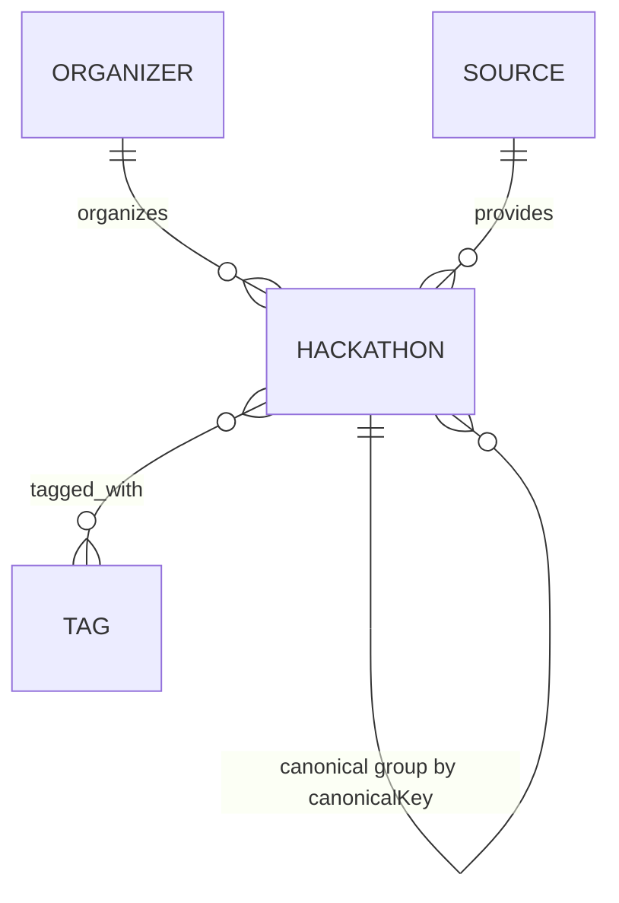

# Hackathon data model

## Relationships

- `Hackathon.organizer` and `Hackathon.source` are references because those records are shared by many hackathons and have independently managed metadata.
- Collection names are explicitly aligned with the Python importer (`Hackathons`, `Organizers`, `Sources`, `Tags`) so Mongoose population resolves the same documents the importer writes.
- `Hackathon.tags` references shared `Tag` records so names can be normalized once. `tagNames` is a denormalized search field, maintained during ingestion and backfillable.
- Skills and domains remain embedded string arrays because they are values used with a hackathon, not independently managed entities in the current backend.
- Multi-source records are retained for traceability. `canonicalKey` groups records only when normalized title, organizer, and event start date agree; one record remains `isCanonical: true` and carries the source listings. Records without an event start date are not automatically grouped.

## Index plan

| Index | Purpose |
|---|---|
| Unique `slug` | Resolve stable detail URLs |
| Unique `(source, externalId)` | Idempotent source upserts and per-source duplicate prevention |
| `(canonicalKey, isCanonical)` | Find source duplicates and serve one canonical list item |
| `sourceListings.source` | Filter canonical records by every contributing source |
| Text `(title, description, skills, domain, tagNames)` | Search hackathons and tags |
| `(mode, location, status)` | Common filter combinations |
| `(registrationDeadline, _id)` | Deadline filters and deterministic cursor ordering |
| `(prize, _id)` and `(-prize, _id)` | Prize range filters and both deterministic sort directions |
| `(-createdAt, -_id)` | Newest-first deterministic cursor ordering |
| Unique `Organizer.name`, `Source.name`, `Tag.name` | Prevent duplicate shared lookup records |

Existing records need the data/search migration once before deploying the new schema: `npm run backfill:tag-search`. It reconciles older lowercase Mongoose lookup collections with the importer's capitalized collections, repoints their hackathon references, backfills `tagNames` and `sourceListings`, groups records with an exact canonical key when their source differs, and replaces the old text index. It intentionally retains the legacy collections. Schedule this as a maintenance step because MongoDB allows only one text index per collection.

## Freeze

**Baseline freeze: 2026-10-16.** This records the Week 1 schema and index baseline implemented in this repository. Treat changes to required fields, relationship cardinality, collection names, or unique indexes as schema changes; review migration and importer compatibility before deployment. This repository record does not represent approval by the project team; record that approval separately.

## Database deployment checklist

- Use a separate Atlas cluster/database user and `MONGODB_URI` for each environment; grant the application user only the database role needed to read/write the application database, not project/cluster administration.
- Keep connection strings and importer API keys in environment secrets, never in source control. Configure `MONGODB_MAX_POOL_SIZE` per deployment; the backend defaults to 10 connections and a 10-second server-selection timeout.
- Run the API and importer against the same database name and collection names. Both target `HackHub` by default; set `MONGODB_DATABASE` only when intentionally configuring another matching database for both processes.
- Seed local development data with `$env:NODE_ENV="development"; npm run seed` in PowerShell. The script refuses to run otherwise unless `ALLOW_SEED_DATA=true` is explicitly set.
- After deploying the tag text-index change, run `npm run backfill:tag-search` once before relying on tag search.
